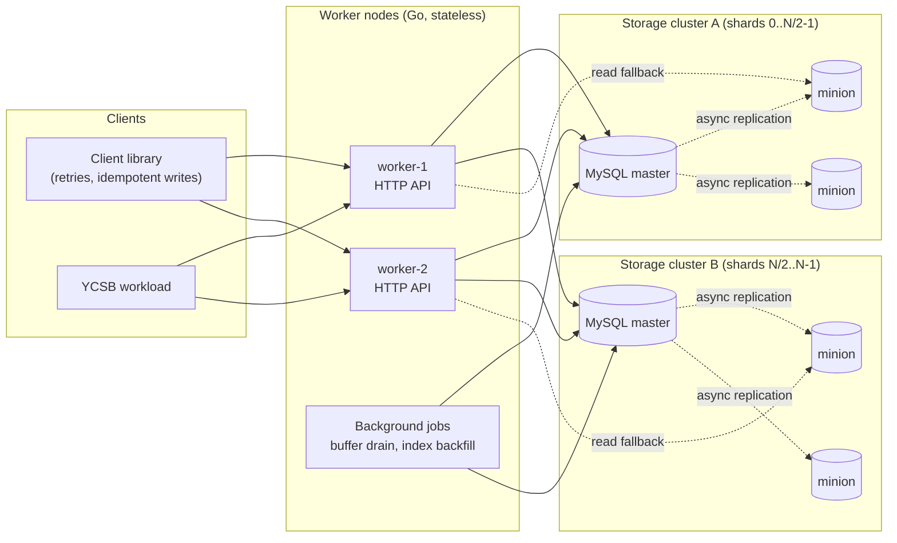
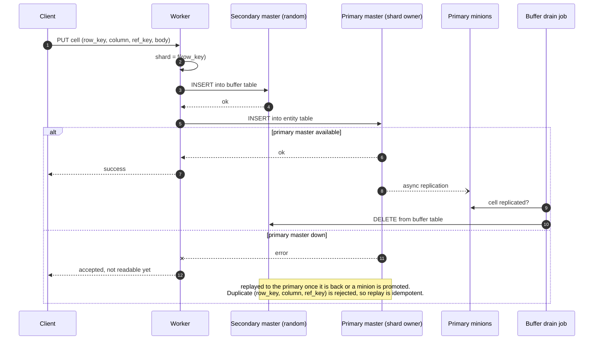

# rebuilding-uber-schemaless

An unofficial reconstruction of Schemaless, the append-only datastore Uber built on top of sharded MySQL, based only on Uber Engineering's public blog posts. The goal is to test how the design behaves under failures (primary crash, network partition, replica promotion) and compare it against native PostgreSQL replication.

> Not affiliated with Uber. Everything here is rebuilt from public writing. Parts the posts do not describe are filled with explicit assumptions, listed in [Documented vs assumed](#documented-vs-assumed).

**Status:** design phase. The architecture and data model below describe what will be built, not what exists yet.

---

## Architecture

Schemaless has two node types. Worker nodes are stateless HTTP services that route requests, fan out to storage, and run background jobs. Storage nodes are MySQL servers. Data is split into a fixed number of shards, each shard lives in one storage cluster, and each cluster has one master and two minions with asynchronous replication.



### Write path (buffered writes)

Every write goes to two clusters: first a randomly chosen secondary master, into a buffer table, then the primary master of the shard. The client only gets success when both succeed. A background job removes the buffered copy once the cell shows up on the primary minions. If the primary master is down, the write still succeeds on the secondary and becomes readable after the master returns or a minion is promoted.



### Read path

Reads go to the master by default, so a client sees its own writes. Reading from a minion can be chosen per request. When the master is unhealthy (detected with a circuit breaker on storage connections), reads fail over to a minion and may return stale data.

---

## Data model

The smallest unit is a **cell**: an immutable JSON blob addressed by three keys.

| Key | Type | Meaning |
|:---|:---|:---|
| `row_key` | UUID | Like a primary key, also decides the shard |
| `column_name` | string | Defined by the application, no schema enforced |
| `ref_key` | integer | Version of the cell. The highest `ref_key` is the current value |

Cells are never updated in place. An update is a new cell with a higher `ref_key`, so each shard is effectively a log of cell revisions. Rows do not need to share columns.

Example from Uber's trip store (simplified):

| row_key | BASE | STATUS | NOTES | FARE_ADJUSTMENT |
|:---|:---|:---|:---|:---|
| trip_uuid1 | ref 1 | ref 1, ref 2 | | |
| trip_uuid2 | ref 1, ref 2 | | ref 1 | |

### MySQL layout

Each shard is a separate MySQL database. A MySQL server holds many shard databases. Each shard database has one entity table, one table per secondary index, and auxiliary tables.

```sql
-- entity table, as described in Schemaless Part 2
CREATE TABLE entity (
    added_id    BIGINT NOT NULL AUTO_INCREMENT,   -- PK, keeps inserts sequential on disk
    row_key     BINARY(16) NOT NULL,              -- UUID
    column_name VARCHAR(64) NOT NULL,
    ref_key     BIGINT NOT NULL,
    body        MEDIUMBLOB NOT NULL,              -- MessagePack + zlib compressed JSON
    created_at  DATETIME(6) NOT NULL,
    PRIMARY KEY (added_id),
    UNIQUE KEY cell (row_key, column_name, ref_key)
) ENGINE=InnoDB;

-- buffer table on the secondary master (layout is an assumption, see below)
CREATE TABLE buffered_cell (
    added_id      BIGINT NOT NULL AUTO_INCREMENT,
    target_shard  INT NOT NULL,
    row_key       BINARY(16) NOT NULL,
    column_name   VARCHAR(64) NOT NULL,
    ref_key       BIGINT NOT NULL,
    body          MEDIUMBLOB NOT NULL,
    created_at    DATETIME(6) NOT NULL,
    PRIMARY KEY (added_id),
    UNIQUE KEY cell (target_shard, row_key, column_name, ref_key)
) ENGINE=InnoDB;

-- one table per secondary index, sharded by the index's shard field
-- example: trips by driver
CREATE TABLE index_trips_by_driver (
    driver_uuid BINARY(16) NOT NULL,              -- shard field
    row_key     BINARY(16) NOT NULL,
    city_id     INT,
    created_at  DATETIME(6) NOT NULL,
    PRIMARY KEY (driver_uuid, row_key)
) ENGINE=InnoDB;
```

Uber's post lists the entity table columns and types (`added_id` int auto-increment, `row_key` uuid, `column_name` string, `ref_key` int, `body` blob, `created_at` datetime) and a compound index on `(row_key, column_name, ref_key)`. The exact MySQL types above are our choice. Secondary indexes are eventually consistent: they are written separately from the entity table and can lag behind it.

---

## Documented vs assumed

| Component | Source | Status |
|:---|:---|:---|
| Cell model, append-only, highest `ref_key` wins | Part 1, Part 2 | Documented |
| Worker and storage node split, HTTP API | Part 2 | Documented |
| Fixed shard count (Uber typically uses 4096), one MySQL database per shard | Mezzanine, Part 2 | Documented |
| One master and two minions per cluster, async MySQL replication | Part 2 | Documented |
| Buffered writes to a random secondary master, success only if both writes succeed | Part 2 | Documented |
| Idempotent writes, duplicate `(row_key, column, ref_key)` rejected | Mezzanine, Part 2 | Documented |
| Entity table columns, compound index, MessagePack + zlib body | Part 2 | Documented |
| Secondary indexes sharded by a shard field, eventually consistent | Part 1, Part 2 | Documented |
| Read from master by default, circuit breaker failover to minions | Part 2 | Documented |
| Function mapping `row_key` to shard | Not described | Assumed: hash of UUID mod shard count |
| Buffer table schema | Not described | Assumed: layout above |
| Who promotes a minion, and when | Not described | Assumed, tested in more than one variant |
| Fencing of an old master that comes back after promotion | Not described | Assumed, tested in more than one variant |
| How workers learn the current master of each cluster | Not described | Assumed: static config reloaded by a coordinator |
| Write failure detection and timeouts | Not described | Assumed |
| Resharding | Not described | Out of scope |
| Triggers (change notification) | Part 1 | Out of scope for the first version |

Scenarios that depend on an assumed component are reported separately from scenarios that only use documented behavior.

---

## Tech stack

| Layer | Technology | Notes |
|:---|:---|:---|
| Worker service | Go, `net/http` | Stateless HTTP API, shard routing, buffered writes, background jobs |
| MySQL driver | `go-sql-driver/mysql` | |
| Cell encoding | MessagePack (`vmihailenco/msgpack`) + `compress/zlib` | Same encoding Uber reported using |
| Storage | MySQL 8.0, InnoDB | Async replication, one master and two minions per cluster |
| Baseline | PostgreSQL with streaming replication | Version pinned and reported with every result |
| Local cluster | Docker Compose | One container per MySQL and PostgreSQL node |
| Workload | YCSB | Same workload for both systems |
| Fault injection | `docker kill` / `docker pause`, `iptables` and `tc netem` | Crash, partition, slow links |
| History checking | Client-side operation log, checked with Elle | Lost acknowledged writes, stale reads, consistency anomalies |

---

## Experiments

Each scenario runs on both the Schemaless rebuild and native PostgreSQL with the same hardware, workload, and replication settings.

| Scenario | What happens |
|:---|:---|
| Primary crash | Kill the master of one cluster during a write-heavy workload |
| Network partition | Isolate one node (master, minion, or worker) from the rest |
| Replica promotion | Promote a minion while writes are in flight, then bring the old master back |

Metrics:

- **Data loss**: writes acknowledged to the client that are missing after recovery.
- **Inconsistency**: stale reads and other anomalies found in the client-side history.
- **Recovery time**: time from the fault until the system serves reads and writes again.
- **Write availability**: share of writes that succeed while the fault is active.

---

## References

1. R. Schmidt, "Project Mezzanine: The Great Migration," Uber Engineering Blog, Jul. 2015. https://www.uber.com/gb/en/blog/mezzanine-codebase-data-migration/
2. J. H. Thomsen, "Designing Schemaless, Uber Engineering's Scalable Datastore Using MySQL," Uber Engineering Blog, Jan. 2016. https://www.uber.com/us/en/blog/schemaless-part-one-mysql-datastore/
3. J. H. Thomsen, "The Architecture of Schemaless, Uber Engineering's Trip Datastore Using MySQL," Uber Engineering Blog, Jan. 2016. https://www.uber.com/us/en/blog/schemaless-part-two-architecture/
4. B. Taylor, "How FriendFeed uses MySQL to store schema-less data," Feb. 2009. https://backchannel.org/blog/friendfeed-schemaless-mysql
5. A. Alquraan, H. Takruri, M. Alfatafta, S. Al-Kiswany, "An Analysis of Network-Partitioning Failures in Cloud Systems," OSDI 2018. https://www.usenix.org/conference/osdi18/presentation/alquraan
